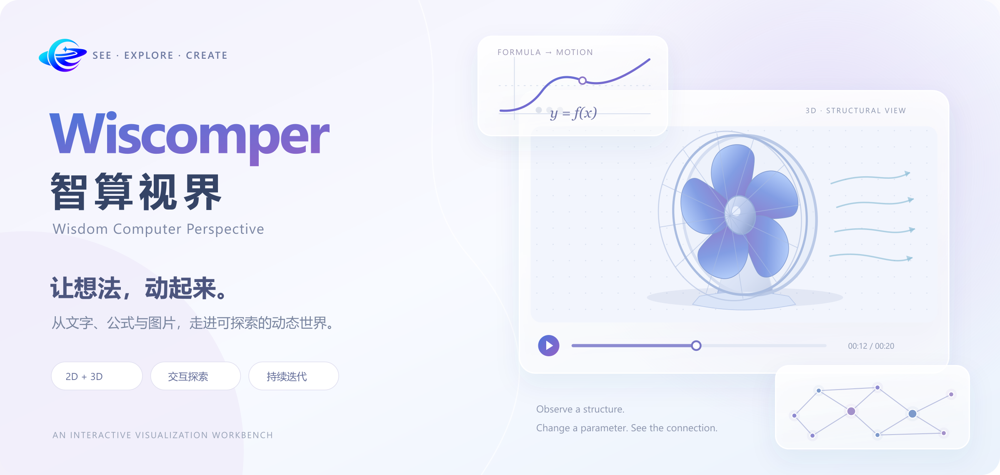
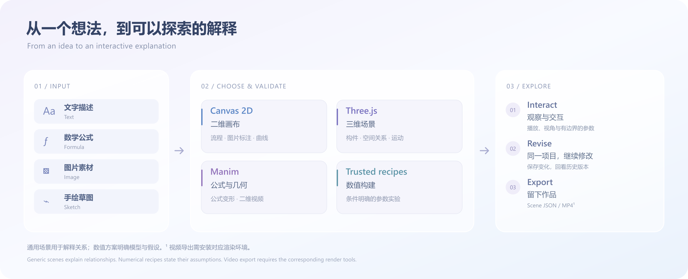

<a id="top"></a>
<p align="center">
  
</p>

<h1 align="center">Wiscomper · 智算视界</h1>
<p align="center"><strong>Wisdom Computer Perspective</strong><br>Turn an idea into a scene you can observe, interact with, and explore.</p>

<p align="center"><a href="README.md">简体中文</a> · <strong>English</strong></p>
<p align="center">
  <a href="#quick-start"></a>
  <a href="#quick-start"></a>
  <a href="#visual-tools"></a>
  <a href="#export"></a>
  <a href="#models-and-accounts"></a>
</p>
<p align="center">
  <a href="https://www.wiscomper.com/">Website</a> · <a href="#quick-start">Quick start</a> · <a href="#features">Features</a> · <a href="#deployment">Deployment</a> · <a href="#documentation">Documentation</a>
</p>

---

Wiscomper is an interactive visualization workbench. Start with a description or formula, upload an image, or draw a sketch. The workbench selects a representation that fits the content. You can then rotate the view, adjust parameters, and describe what to refine.

The interface follows Wiscomper’s blue and violet palette. The formula library and knowledge graph connect projects with learning materials. Keep refining the same project, preserve earlier versions, and export a video or scene data when ready.

<a id="features"></a>
## Put an idea into motion

| What you want to do | How the workbench helps |
| --- | --- |
| Understand structures and motion | 3D components, orbit and zoom, with scene-defined angle, assembly, or linked controls |
| Explain a mathematical process | LaTeX, curves, numerical examples, and matching formula transformations in Manim exports |
| Refine the same project | Describe a partial edit, select an object, inspect history, or restore an earlier version |
| Build a learning space | Formula library, connected graph, mistake records, timestamped notes, and lesson packs |
| Find what you need | `Ctrl / ⌘ K` search, a floating task hub, and a replayable onboarding tour |
| Save or share the result | Scene JSON, formula-library JSON, and MP4 with a configured renderer |

The 12 built-in examples include a fan, functions, a pendulum, refraction, and queueing. Local examples and parameter exploration do not call a model.

<p align="center"></p>

<a id="visual-tools"></a>
### Choose a medium that fits the content

| Content | Representation |
| --- | --- |
| Spatial structures and mechanical motion | **Three.js** scenes with orbit controls and bounded degrees of freedom |
| Formula changes and 2D geometry | Mathematical web previews, with **Manim** for matching-symbol video transformations |
| Processes, image annotations, and 2D relationships | **Canvas 2D** layers, paths, and keyframes |
| Functions and physical examples | Fixed Python builders recalculate results when parameters change |

You can explicitly request 2D or 3D. Custom interactions use constrained data bindings; model output is not executed as arbitrary Python or JavaScript.

<a id="quick-start"></a>
## Quick start

Use **Python 3.11+**; **Node.js 24** is recommended. The supported Node range is `^22.19.0 || >=24.0.0`: 22.19.0 or newer in the 22.x series, or version 24 and above. The Windows launcher additionally requires PowerShell 7.

```bash
git clone https://github.com/rainbowyuyu/Wisdom_Computing_Perspective.git
cd Wisdom_Computing_Perspective/wiscomper
```

The repository retains the legacy site in `html_root/`; the new workbench is in `wiscomper/`. Run the following commands from the new workbench directory.

<details open>
<summary><strong>Windows · Local launch</strong></summary>

```powershell
py -3 -m venv .venv
.venv/Scripts/python.exe -m pip install -r requirements.txt
npm ci
pwsh -NoProfile -File ./Start.ps1
```

Open `http://127.0.0.1:3088/`. Once the environment is installed, you can also use `万象世界.exe` in the project root. Its original filename is retained for compatibility. The EXE loads external scripts, so website updates do not require recompiling the launcher.

Stop a launcher-managed service with `pwsh -NoProfile -File ./Stop.ps1`. Stop a manually launched service from its original terminal.

</details>

<details>
<summary><strong>Linux · Standalone local run</strong></summary>

```bash
python3 -m venv .venv
.venv/bin/python -m pip install -r requirements.txt
npm ci
.venv/bin/python main.py
```

The default listener is `127.0.0.1:3088`. Public access requires a configured HTTPS origin and reverse proxy; see [public deployment](docs/deployment.md). To replace a legacy Baota site, use the [data-preserving deployment procedure](deploy/DEPLOY-PACKAGE.md).

</details>

Try a built-in example first. Configure a model using [.env.example](.env.example) when you want to generate your own content. Preserve an existing `.env` instead of overwriting it.

<a id="models-and-accounts"></a>
## Models and accounts

| Access | Available models |
| --- | --- |
| Standard online account | Qwen, subject to login, applicable email verification, and site quotas |
| VIP / administrator | Configured Qwen, ChatGPT, and Claude connections; site-wide budgets still apply |
| Direct local workbench access | All configured models; the local exception is disabled in public mode |

**Qwen is the default.** Windows uses local global Qwen tools and the current user’s DPAPI credential. Linux can read `ALIYUN_KEY` or `DASHSCOPE_API_KEY` from private server configuration. ChatGPT and Claude support local provider configuration or independent server settings. See [Runtime](runtime/README.md) for fields and connection boundaries.

**Email access** supports username/email and password login, verification-code registration, email binding verification, and password reset. Verification flows require SMTP. **GitHub login** requires an OAuth App with a matching callback; it cannot complete without a configured Client Secret. Matching names do not automatically merge GitHub and legacy email accounts.

[Legacy accounts](docs/legacy-accounts.md) · [Local GitHub setup](docs/github-local-setup.md) · [Public OAuth and HTTPS](docs/deployment.md)

<a id="export"></a>
## From an interactive preview to a video

Scene JSON can be exported directly. MP4 supports 1280 × 720 at 15 / 24 fps and needs additional rendering dependencies:

- **2D / 3D browser export:** FFmpeg and an available Chrome, Edge, or Playwright Chromium installation.
- **Manim 2D export:** install `requirements-manim.txt` and provide FFmpeg, LaTeX, and dvisvgm. Linux also needs the relevant Cairo/Pango system libraries.

Exploration parameters and the camera view are saved with the project. Video export uses fixed renderers without additional model calls; the interface reports unavailable dependencies. See the [full guide](docs/guide.zh-CN.md#视频导出) for installation commands and export details.

<a id="deployment"></a>
## Update the application, keep existing data

The deployment package checks the target, backs up replaced files, and supports rollback. It preserves the legacy `.env`, `.env.local`, MySQL database, and uploaded files. New workbench data defaults to the separate `var/wiscomper-harness/` directory. The installer does not execute database creation or deletion SQL.

Follow the [package instructions](deploy/DEPLOY-PACKAGE.md), upload and extract the package, and stop the original Baota service. From the extracted package, run:

```bash
python3 deploy.py install --target /www/wwwroot/wiscomper.com
```

The startup command remains `python main.py`. Initial deployment also requires checking the Nginx proxy, service-user permissions, and system dependencies. Isolated local checks have been performed; production deployment still requires validation on the actual server. The website link does not imply that this version is already live.

Legacy accounts can use the original database, with an import path for formulas, notes, and mistake records. Older videos and lesson packs remain stored but are not all mapped into the new interface. See [migration scope](docs/legacy-accounts.md#旧学习资料).

<a id="documentation"></a>
## Documentation

| Topic | Read |
| --- | --- |
| Detailed usage, launcher, and storage | [Full Chinese guide](docs/guide.zh-CN.md) |
| Tool selection and scene validation | [Runtime](runtime/README.md) · [Scene contract](docs/contract.md) |
| Interaction bindings and exploration state | [Interaction contract](docs/interaction-contract.md) |
| Email, legacy database, and learning imports | [Account compatibility](docs/legacy-accounts.md) |
| HTTPS, OAuth, deployment, and rollback | [Public deployment](docs/deployment.md) · [Deployment package](deploy/DEPLOY-PACKAGE.md) |
| Recorded checks and their scope | [Verification notes](docs/verification.md) |

This README provides the English overview and setup path. Most detailed operational documents currently remain in Chinese; runtime documentation is in English.

<details>
<summary><strong>Development checks and directories</strong></summary>

```bash
# Run inside the project's virtual environment
python -m pytest -q
npm run test:runtime
```

`server/` owns APIs and persistence; `runtime/` runs the bounded model workflow; `web/` contains the workbench. Regression tests live in `tests/`, with deployment utilities in `deploy/` and `tools/`. Browser tests and video exports need their corresponding environments.

Keep real `.env` files, databases, user projects, and logs in the runtime environment and out of Git. Credentials stay on the server. Tasks have call and time limits; the server enforces permissions and ownership.

</details>

## Scope

“Bring ideas into motion” describes the direction of the visualization tools. Generic 3D structures and airflow are illustrative. A single image cannot reliably recover real dimensions or a complete 3D model. Numerical examples explain behavior within their stated assumptions; displaying a formula is not an automatic proof. Check important results against the original question, units, and applicable conditions.

<p align="center"><a href="#top">↑ Back to top</a> · <a href="README.md">阅读中文版</a> · <a href="https://www.wiscomper.com/">Wiscomper</a></p>
